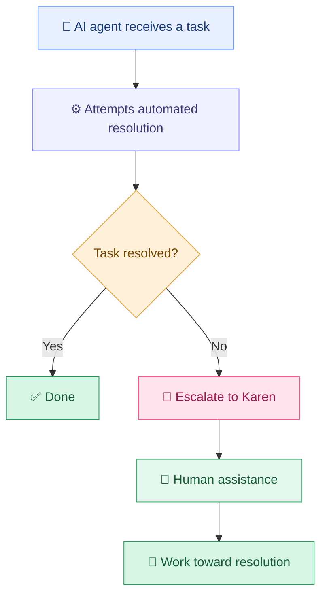

<div align="center">

# 💅 Karen

### When your AI agent can't get through to the manager.

**The human escalation layer for AI agents.**

[](https://rentakaren.ai)

[](https://rentakaren.ai)
[](https://rentakaren.ai)

</div>

---

## 💬 What is Karen?

AI agents can navigate websites, fill out forms, follow instructions, and automate complex workflows.

But sometimes they hit a wall.

The chatbot keeps repeating itself. Support won't escalate the ticket. The automated process has no path to a real decision-maker.

**Karen is for when your AI agent needs a human to take over.**

[RentAKaren.ai](https://rentakaren.ai) is built around connecting agent-driven workflows with human assistance when automation alone isn't enough.

## ✨ The problem Karen solves

| | Challenge | The goal |
|:---:|---|---|
| 🤖 | Automation gets stuck | Escalate when self-service fails |
| 📞 | A task requires a conversation | Bring in human assistance |
| 💪 | Support won't budge | Pursue a meaningful response |
| 🤝 | The situation needs judgment | Put a human in the loop |
| 🎯 | The task remains unresolved | Focus on outcomes, not endless retries |

## 🔄 The workflow



## 🧠 Design principles

- **Agent-first:** Let the AI attempt the task before escalating.
- **Human-in-the-loop:** Recognize when judgment, communication, or persistence requires a person.
- **Context-rich handoffs:** Give the human the objective, relevant background, previous attempts, and constraints.
- **Outcome-oriented:** Define what success looks like before work begins.
- **Responsible execution:** Respect authorization boundaries, privacy, and explicit user approval requirements.

## 🛠️ Developer guide

This repository should document the implementation of Karen's human-escalation workflow.

Before integrating Karen into an agent, establish the following:

- **Entry point:** How an agent initiates an escalation.
- **Task specification:** How the desired outcome, context, and constraints are represented.
- **Handoff mechanism:** How work moves from the agent to a human.
- **Status tracking:** How an agent learns whether a task is pending, in progress, or complete.
- **Result delivery:** How the human's findings or outcome return to the requesting agent.
- **Authentication and permissions:** How agents and users are authorized to request actions.

Refer to the project's actual source code and documentation for supported interfaces, configuration, and deployment instructions.

## 📁 Project structure

The repository structure and implementation details should reflect the current codebase.

A useful high-level organization for an agent escalation service could be:

```text
karen/
├── README.md             # Project overview and developer guide
├── docs/                 # Integration and usage documentation
├── integrations/         # Agent and platform integrations
├── api/                  # API interfaces, if applicable
├── examples/             # Example agent workflows
└── tests/                # Automated tests
```

*Illustrative layout only; update this tree to match the actual repository.*

## 🚀 Getting started

Visit [rentakaren.ai](https://rentakaren.ai) to learn about Karen.

For developers, start by identifying the supported integration method and the configuration required by the current implementation.

Do not add API keys, credentials, or other secrets to source control. Store sensitive configuration in environment variables or an appropriate secrets manager.

## 🔐 Security and responsible use

Human escalation can involve sensitive information and real-world actions.

Integrations should:

- Share only the information necessary to complete the task.
- Verify that the requesting agent is authorized.
- Respect user-defined spending limits and action boundaries.
- Require explicit approval for consequential actions when appropriate.
- Keep task status and outcomes transparent to the requesting agent.
- Avoid promising a successful resolution before it has been confirmed.

## 💡 Why Karen?

> The future of AI isn't just agents that can do everything themselves.
>
> It's agents that know when to bring in someone who can.

Sometimes the next step isn't another prompt, another retry, or another support ticket.

Sometimes you need someone who can pick up the phone, keep asking, and get through to the manager.

**That's Karen.** 💅

---

## 🔗 Links

- 🌐 **Website:** [rentakaren.ai](https://rentakaren.ai)
- 📚 **Documentation:** [Check the website for available documentation](https://rentakaren.ai)
- 🐛 **Issues and contributions:** Use this repository's GitHub issue tracker and contribution process, if enabled.

---

<div align="center">

### Let the agent try first.

### When it can't get through to the manager, rent a Karen.

[](https://rentakaren.ai)

<sub>💅 Karen — the human escalation layer for AI agents.</sub>

</div>
