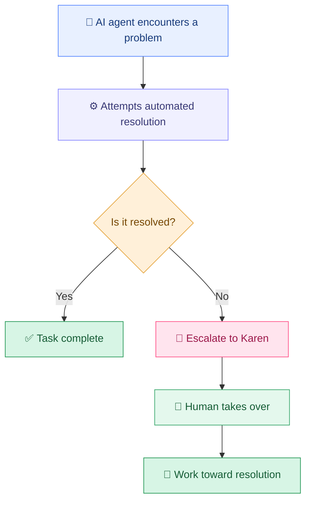

# 💅 Karen

### When your AI agent can't get through to the manager.

**Your agent handles the machine. Karen handles the humans.**

*The human escalation layer for AI agents.*

---

## 💬 The problem

AI agents can reason, negotiate, fill out forms, and navigate support flows.

But what happens when the chatbot goes in circles, the support ticket goes nowhere, and nobody will connect you to someone who can actually make a decision?

**You get a Karen. 💅**

[RentAKaren.ai](https://rentakaren.ai) is built around a simple idea: when an AI agent can't finish a task on its own, bring in a human who can help get it done.

Your agent tries first. Karen steps in when automation hits a wall.

---

## ✨ What Karen does

| | Capability | What it means |
|:---:|---|---|
| 🤖 | **Automation fallback** | Escalate when the agent exhausts self-service options. |
| 📞 | **Human intervention** | Get help with tasks requiring calls, conversations, or direct follow-up. |
| 💪 | **Escalation** | Push past scripted responses and dead-end support flows. |
| 🤝 | **Negotiation** | Bring human judgment to situations where automated messages aren't enough. |
| 🎯 | **Outcome-oriented** | Focus on resolving the problem, not opening another ticket. |

---

## 🔄 How it works

**The idea is simple:** don't make your AI agent give up just because the next step requires a human.

---

## 🚧 When automation hits a wall

### 🎧 Customer support

Your agent has tried the FAQ, help center, chatbot, and support form. Nothing works. Karen helps take the issue beyond the automated front door.

### 💰 Negotiation

Your agent knows what it wants but can't get a meaningful response. A human can communicate, make the case, and negotiate toward a resolution.

### 🏛️ Bureaucracy and red tape

Some processes require persistence, judgment, and direct human communication. Karen helps bridge the gap between digital automation and the real world.

### 🌍 Real-world follow-through

When a task needs a conversation, local context, or someone willing to take the next step, Karen provides a path to human assistance.

---

## 🧠 Built for AI agents

Karen treats human assistance as another step in completing a task — not a failure state.

A useful handoff should include:

- 🎯 **Objective** — what needs to happen.
- 📝 **Context** — what the agent has already tried and what happened.
- 🚧 **Constraints** — deadlines, budget, boundaries, and approval requirements.
- ✅ **Success criteria** — what counts as a resolution.

The better the handoff, the less time a human spends reconstructing the problem and the more time they can spend solving it.

---

## 🛠️ Designed for the agentic era

AI agents are increasingly capable of operating software, navigating websites, and executing complex workflows.

But the world isn't entirely programmable.

Some organizations hide behind automated support systems. Some decisions require a conversation. Some problems need persistence, judgment, and a person willing to follow through.

Karen represents the human fallback for these situations.

**When software can't solve the problem, escalate beyond software.**

---

## 💡 The philosophy

> The future of AI isn't just agents that can do everything themselves.
>
> It's agents that know when to bring in someone who can.

Intelligence alone doesn't grant access, authority, persistence, or a human voice.

Sometimes you need someone who can pick up the phone.

Sometimes you need someone who can keep asking.

Sometimes you need someone who can get past the script and talk to the manager.

**That's Karen.** 💅

---

## 🚀 Get started

### Let the agent try first.

### When it can't get through to the manager, rent a Karen.

**Website:** [rentakaren.ai](https://rentakaren.ai)

---

💅 Karen — for when your AI agent needs to speak to a human.

